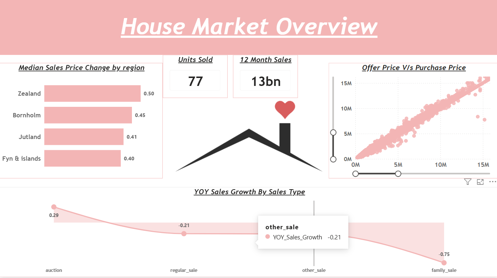
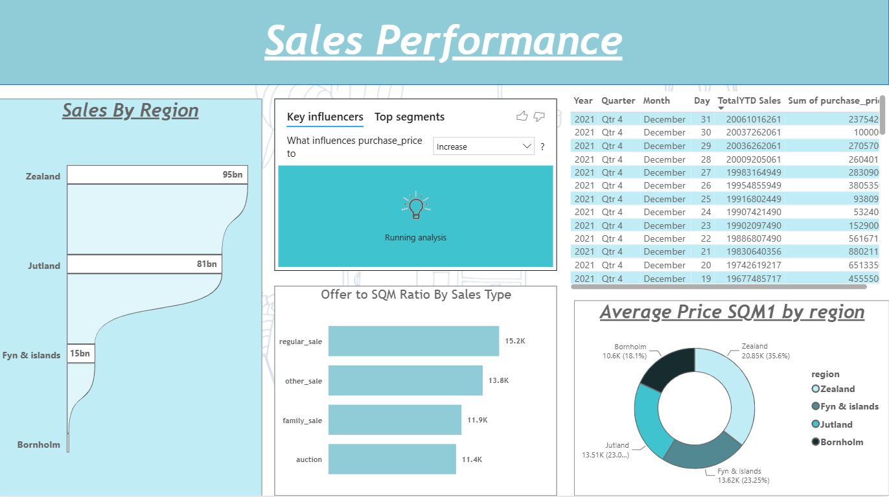
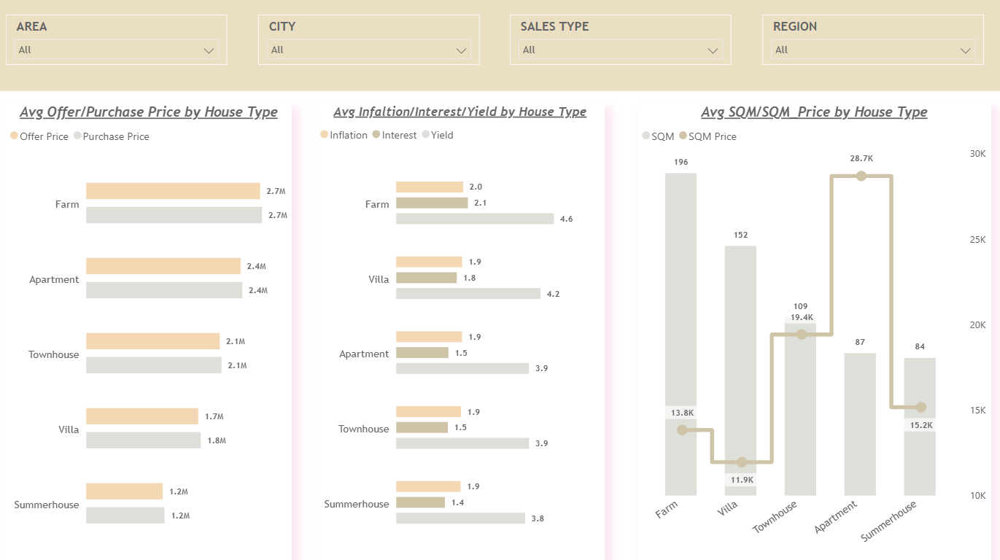

# 🏠 House Market Analysis Dashboard | Power BI

##  Project Overview

This project focuses on analyzing house market trends,
sales performance, regional pricing and house type analysis
using Microsoft Power BI.

The dashboard provides insights into sales growth,
house pricing, regional performance and property trends.

This project was developed as part of my Power BI
learning journey through a guided Udemy course.

##  Tools & Technologies

- Microsoft Power BI
- Power Query Editor
- DAX
- Google BigQuery
- SQL

##  Dashboard Pages

### 1. House Market Overview

- Median Sales Price Change by Region
- Units Sold
- Last 12 Months Sales
- Offer Price vs Purchase Price
- YOY Sales Growth

### 2. Sales Performance

- Sales by Region
- Key Influencers Analysis
- Sales Type Analysis
- Average Price Analysis

### 3. House Type Analysis

- Average Offer/Purchase Price
- Inflation, Interest and Yield
- SQM and SQM Price Analysis

##  DAX Concepts Used

- CALCULATE
- DISTINCTCOUNT
- MEDIANX
- DATESINPERIOD
- TOTALYTD
- ALLEXCEPT
- IF
- MAX
- BLANK

## Key Learning Outcomes

- Data understanding and transformation
- Data cleaning using Power Query
- DAX calculations
- Interactive dashboard development
- Business data visualization

##  Acknowledgement

Developed by following a guided Udemy course.
Dashboard implementation and report creation
were performed by me.
